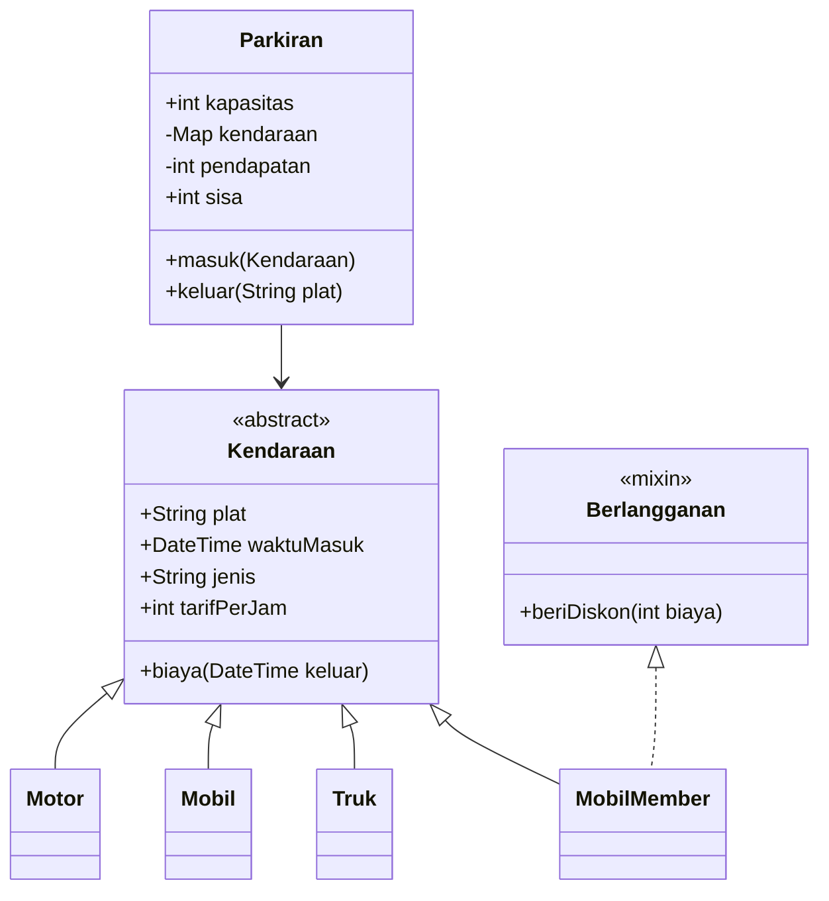
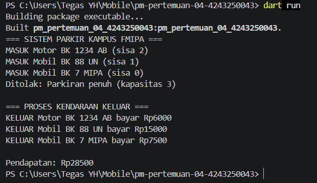

# Sistem Parkir Kampus FMIPA

## Identitas
- Nama: Tegas Ramadhan
- NIM: 4243250043
- Program Studi: Ilmu Komputer
- Universitas: Universitas Negeri Medan

## Deskripsi Proyek
Program Sistem Parkir Kampus FMIPA merupakan aplikasi berbasis console menggunakan bahasa Dart. Program ini digunakan untuk menyimulasikan proses kendaraan masuk dan keluar, menghitung biaya parkir, serta mengelola kapasitas parkir.

## Cara Menjalankan Program

Pastikan Dart SDK sudah terpasang.

1. Buka terminal pada folder proyek.
2. Jalankan perintah `dart pub get`.
3. Jalankan program menggunakan `dart run`.

```powershell
dart pub get
dart run
```

## Fitur
1. Pengelolaan kendaraan Motor, Mobil, dan Truk.
2. Perhitungan tarif parkir berdasarkan durasi.
3. Diskon 50% untuk kendaraan member.
4. Pembatasan kapasitas parkir.
5. Proses masuk dan keluar secara asynchronous.
6. Pencatatan aktivitas menggunakan Stream.
7. Perhitungan total pendapatan parkir.

## Diagram Class



## Screenshot Program



## Penerapan Konsep OOP dan Asynchronous

Enkapsulasi diterapkan pada class Parkiran dengan menggunakan atribut private `_kendaraan` dan `_pendapatan` agar data kendaraan serta pendapatan tidak dapat diakses atau diubah secara langsung dari luar class. Informasi yang diperlukan disediakan melalui getter `sisa` dan `pendapatan`.

Polimorfisme diterapkan melalui abstract class Kendaraan yang memiliki turunan Motor, Mobil, Truk, dan MobilMember. Setiap jenis kendaraan memiliki tarif per jam yang berbeda, tetapi dapat dikelola menggunakan satu tipe data Kendaraan. Mixin Berlangganan digunakan untuk memberikan potongan biaya sebesar 50% kepada MobilMember.

Konsep asynchronous diterapkan menggunakan Future, async, dan await pada proses masuk dan keluar kendaraan. Future.delayed digunakan untuk menyimulasikan waktu kerja palang parkir otomatis. Selain itu, StreamController.broadcast digunakan untuk mengirimkan setiap aktivitas parkir agar dapat ditampilkan pada pos penjagaan.

## Pernyataan Penggunaan AI

Dalam pengerjaan proyek ini, AI digunakan sebagai alat bantu untuk memahami konsep pemrograman Dart, menyusun struktur kode, dan membantu proses pemeriksaan kesalahan. Pengujian dan pemahaman program tetap dilakukan oleh penulis.

## Hasil Pengujian

Program telah diuji menggunakan perintah `dart run` dengan hasil:

- Kendaraan Motor berhasil masuk dan keluar.
- Kendaraan Mobil berhasil masuk dan keluar.
- Kendaraan MobilMember mendapatkan diskon 50%.
- Kendaraan keempat ditolak ketika parkiran penuh.
- Total pendapatan parkir sebesar Rp28.500.